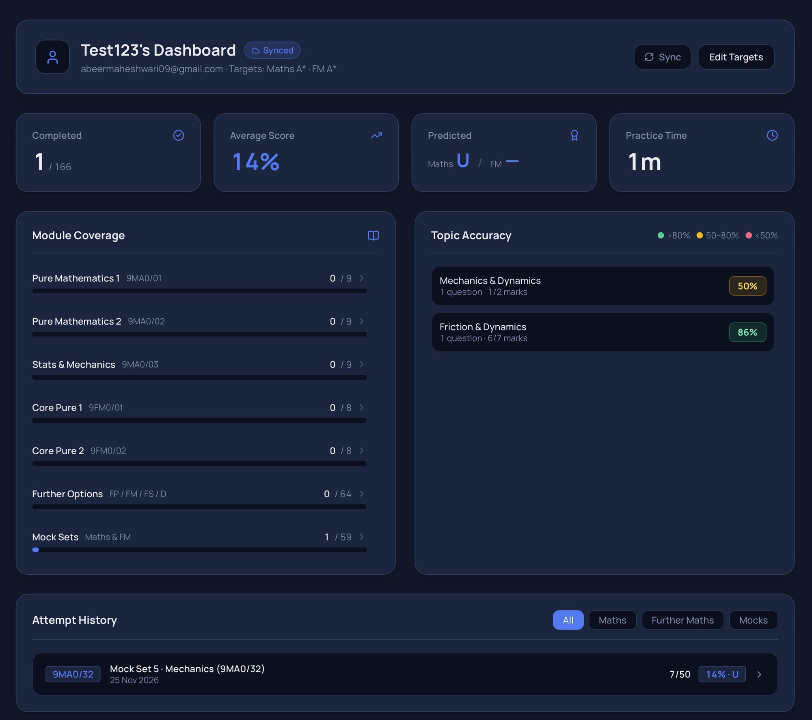
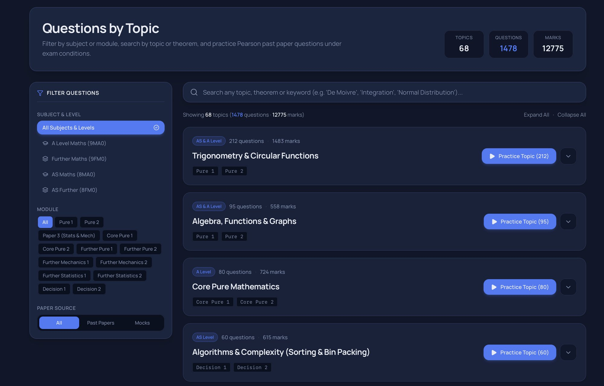
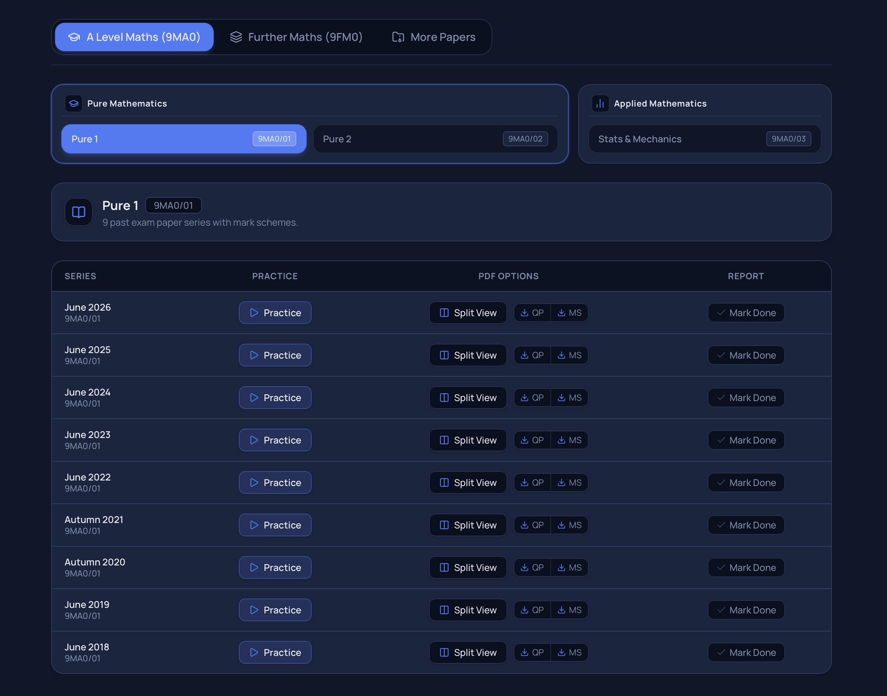
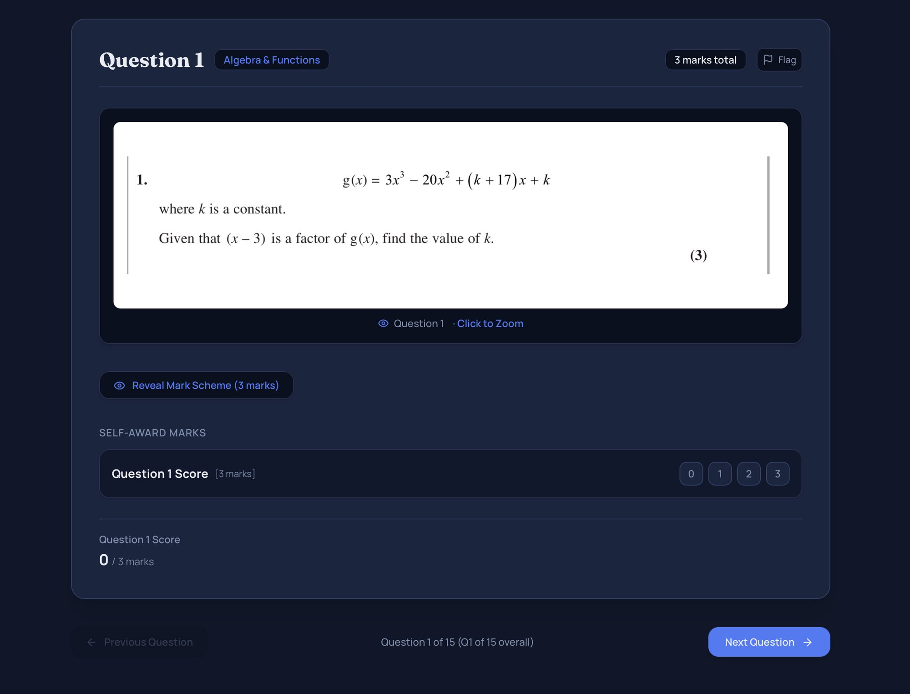
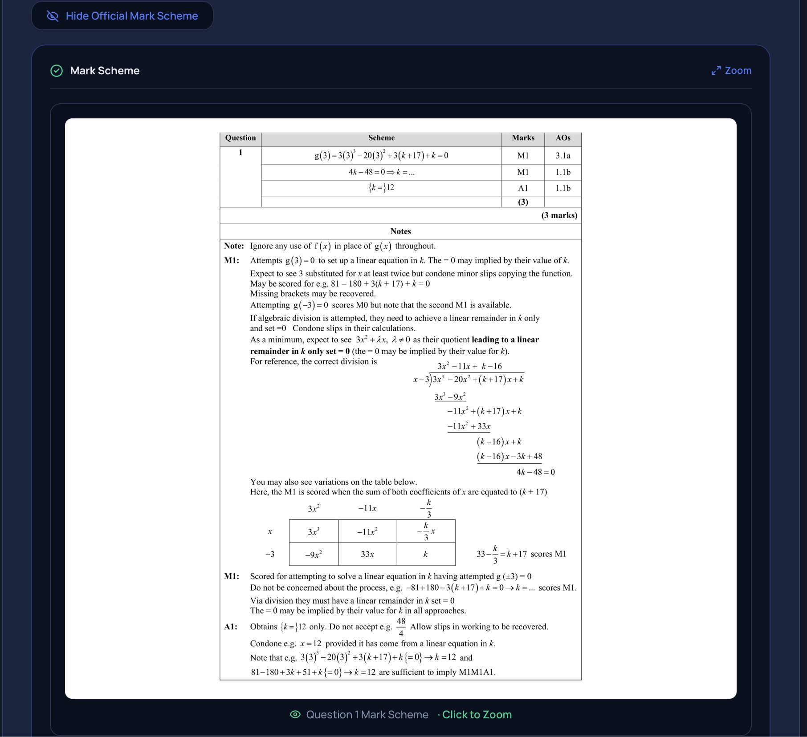

<div align="center">


# matheseus

**Edexcel A Level Maths & Further Maths past papers, mock sets, and topic practice.**

<p align="center">
  <a href="https://matheseus.freedev.app"></a>
  
  
  
  <br>
  
  
  
  
  
</p>

**matheseus** brings the latest **Pearson Edexcel A Level Maths (`9MA0`)** and **Further Maths (`9FM0`)**
past papers (including **2025 & 2026** series) together with **50+ official Pearson Edexcel Mock Sets**, question-by-question
practice, official mark schemes, and cross-device progress tracking at [matheseus.freedev.app](https://matheseus.freedev.app).

</div>

---

## Features

<table>
<tr>
<td width="50%" valign="top">

**Latest Past Papers**

- Full Edexcel `9MA0` and `9FM0` archive up to **June 2026**
- Covers Pure 1, Pure 2, Paper 3 (Stats & Mechanics), Core Pure 1/2, and Further options (`FP1/2`, `FM1/2`, `FS1/2`, `D1/2`)
- Official Question Papers and Mark Schemes in side-by-side Split View
- Direct QP and MS PDF downloads plus completion status toggles

</td>
<td width="50%" valign="top">

**Mock Sets**

- **50+ official Pearson Edexcel Mock Sets** spanning Maths and Further Maths (`Set 1` onwards)
- Organised by mock series alongside module breakdowns
- Full Interactive Practice Mode and Mark Scheme review for official mock papers
- Tracked separately in Dashboard Module Coverage and Attempt History

</td>
</tr>
<tr>
<td valign="top">

**Questions by Topic**

- **1,400+ questions** (**12,000+ marks**) indexed across **65+ topics**
- Filter by subject (`9MA0`, `9FM0`, `8MA0`, `8FM0`), module, or keyword
- Switch source between All, Past Papers only, or Mock Sets only
- Launch focused topic runs under exam conditions

</td>
<td valign="top">

**Practice Mode**

- Cropped official question and mark scheme cards with zoom view
- Step-by-step mark pills for fast self-marking
- Flag questions, track per-question scores, and review breakdowns
- Built-in exam timer with presets and audio alerts

</td>
</tr>
<tr>
<td valign="top">

**Dashboard & Sync**

- Completion progress across `160+` tracked papers and mocks
- Average score, practice time, and live predicted A Level grades
- Topic Accuracy breakdown (`>80%` green, `50–80%` amber, `<50%` red)
- Optional Supabase accounts to sync progress across devices

</td>
<td valign="top">

**Exam Tools**

- Official Edexcel Grade Boundaries explorer (`A*`–`E`)
- Marks-to-next-grade boundary calculator
- Searchable Formula Sheet with KaTeX rendering
- Built-in Maths & Further Maths PDF Formula Booklets

</td>
</tr>
</table>

---

## Screenshots

<table>
  <tr>
    <td></td>
    <td></td>
  </tr>
  <tr>
    <td></td>
    <td></td>
  </tr>
  <tr>
    <td colspan="2" align="center"></td>
  </tr>
</table>

---

## Live App

<p align="center">
  <a href="https://matheseus.freedev.app">
    
  </a>
</p>

| Section | What's inside |
|---|---|
| Past Papers | Series from 2018 through June 2026 across `9MA0` and `9FM0` |
| Mock Sets | Official Pearson Edexcel mock sets across Maths and Further Maths (`50+` papers) |
| By Topic | `65+` topic sets with combined Past Paper and Mock Set filtering |
| Dashboard | Synced stats, predicted grades, Module Coverage, and Attempt History |

---

## Building from Source

```bash
git clone https://github.com/Abeer-Maheshwari/matheseus.git
cd matheseus
npm install
cp .env.example .env.local
npm run dev
```

To build for static hosting (packaging the bundle to `deploy-infinityfree/` without the large `papers/` and `crops/` folders):

```bash
npm run build:infinityfree
```

| File | Purpose |
|---|---|
| [`.env.example`](.env.example) | Template for `VITE_SUPABASE_URL`, `VITE_SUPABASE_ANON_KEY`, and `VITE_ASSET_BASE_URL` |
| [`supabase/schema.sql`](supabase/schema.sql) | User profiles, progress sync, and attempt history schema |
| [`src/utils/assets.ts`](src/utils/assets.ts) | Routes `/papers/*` and `/crops/*` URLs to Cloudflare R2 when `VITE_ASSET_BASE_URL` is set |
| [`scripts/build-infinityfree.mjs`](scripts/build-infinityfree.mjs) | Prepares lightweight static output for hosts without the 1.6 GB asset directory |

---

## How It Works

- All past papers (`2018–2026`), mock sets, and `1,400+` question entries live in typed TypeScript indexes under `src/data/`, powering instant client-side filtering and KaTeX formula rendering.
- Large PDF papers and cropped question/mark-scheme images are excluded from Git and served from Cloudflare R2 via `VITE_ASSET_BASE_URL`, while the static SPA shell deploys cleanly anywhere.
- Progress works offline in local storage and syncs to Supabase (`auth` + `profiles`/`attempts`) once signed in.

---

## Disclaimer

This project is not affiliated with, funded, authorized, or endorsed by Pearson Education Limited or Edexcel. All past papers, mark schemes, and formula booklets belong to their respective owners.
